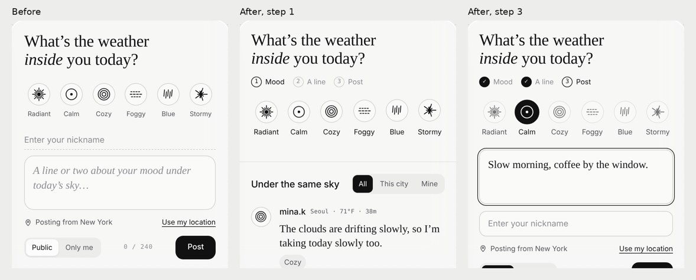

# Atmos · a clearer check in and one design system

Hello World final project · proposal and spike for Week 11 (Nov 23)
Marin Chung

**Atmos v2 (this proposal):** https://hyeeee.github.io/hello-world/week10/atmos-v2/
**Atmos today:** https://atmos-cd-347fa3dcbb.netlify.app/

## 1. Concept and audience

Atmos is a small web app I made in September. It puts live weather and mood journaling in the same place and asks one question, *What's the weather inside you today?* Everyone's answers show up on a shared globe.

For the final I'm not starting something new. I want to keep Atmos and make it better in two ways.

1. **One design system.** Atmos grew fast while I was vibe coding it, so the same kind of thing often looks a bit different in different places.
2. **A check in people actually notice and understand.** Right now the check in is a static form. Everything in it has the same weight, so it's hard to tell where to start.

**Who it's for.** People who check the weather every morning and might spend 20 seconds on a small check in. Classmates and friends who haven't seen Atmos can help test it.

**Why these two.** When I looked at the Atmos data, 162 devices visited but only 31 people posted. On a phone the check in sits below the weather, the forecast, the timeline and the globe, so you have to scroll 3 or 4 screens to even see it. And once you get there, the form doesn't tell you what to do first.

## 2. What I found

**Design system audit** (counted from the CSS of the live site)

| | Before | After (v2) |
|---|---|---|
| Font sizes | 22 different px values (8 to 30, many half pixels like 8.5, 11.5, 15.5) | 7 steps |
| Corner radius | 13 values (2 to 24px) | 4 steps plus pill |
| Spacing values | 18 (including 3, 5, 7, 9, 22, 26px) | 12, on a 2 and 4px rhythm |

Things that do the same job but look different:
- **Toggles.** °C/°F, All/This city/Mine and the globe modes fill with ink when selected, but Public/Only me used a raised white style.
- **Inputs.** The nickname was a dashed underline and the journal was a box.
- **Mood names.** "Cozy" in the picker but "COZY" in small caps mono in the feed.

What I'm keeping on purpose: serif is for people's words and feelings (the question, the journal, posts, today's phrase), and sans is for the interface and data. That rule was already there and I like it, so now it's written down.

## 3. Core experience (v2 check in)

The check in now opens one step at a time, with the same pieces as before.

1. **Mood.** Only the question and the six moods show up at first. The moods are bigger and move very gently, so it's clear this is where you start. A small 1 2 3 line shows where you are.
2. **A line.** After you pick a mood, the text box opens and asks a question that fits your mood, like "What's keeping things calm?" for Calm.
3. **Post.** Once you write something, the nickname, location, Public/Only me and Post appear.
4. **Done.** After posting it says "Posted. You can find it in the feed below." and goes back to step 1.

Recovery stays the same as before. You can change the mood any time, a missing field is still pointed out, and Only me still keeps it private. With reduced motion turned on, the moods don't move.

## 4. Scope

**In one sentence:** keep Atmos as it is, but make it look like one system and make the check in obvious.

| Priority | What |
|---|---|
| Must | Type, radius and spacing scales as tokens, applied across the whole app |
| Must | Same style for every toggle, input and mood tag |
| Must | Step by step check in in EN and KO |
| Must | Test it with people who've never used Atmos |
| Should | On phones, make the check in easier to reach without scrolling so far |
| Should | Dark mode check for every changed part |
| Nice | A small design system page in Claude Design that documents the tokens |

**Stopping point.** A new person can find the check in and post without help on a phone and on a laptop, and nothing in the UI uses values outside the scales.
**What I'd cut first.** The design system page. The tokens in the code are enough for the class.

## 5. System plan

- **Source.** Atmos is built in Claude Design and deployed to Netlify. I'm not touching the live site yet. v2 is a copy built from the live file, and I'll bring the changes back into Claude Design once they're tested.
- **How v2 is made.** `tools/make_v2.py` reads the live Atmos file and
  - snaps every font size, radius and spacing value to the scales and names them as tokens like `--text-sm` and `--radius-md`,
  - gives toggles, inputs and mood tags one shared style,
  - wraps the check in into three steps and adds a small script that opens each step.
- **Data.** Same Supabase as Atmos (`posts`, `devices`, `metoo`, `visits`). No database changes. I added one line so the mood also resets after posting.
- **Tools.** Claude for the code, Playwright to take screenshots on phone and laptop sizes and check nothing broke.

**Tokens**

| Token | Value | Used for |
|---|---|---|
| `--text-xs` | 10px | Mono meta like city, time, counts |
| `--text-sm` | 12px | Captions, toggle buttons, tags |
| `--text-md` | 14px | Body and UI text |
| `--text-lg` | 16px | Section titles |
| `--text-xl` | 18px | People's words (serif) |
| `--text-2xl` | 22px | Brand, Korean question |
| `--text-3xl` | 28px | The question (serif) |
| `--radius-sm / md / lg / xl` | 8 / 12 / 16 / 24px | Inner buttons / controls and inputs / boxes / panels |

## 6. Spike

**Question.** Does the step by step check in help someone who's never seen Atmos find it and finish it?

**Why this one.** This is the riskiest part. The design system cleanup is careful work but I know how to do it. Whether the new check in actually helps people is the part I don't know yet.

**Prediction.** With the old version people will start typing first and only notice the mood or nickname when Post doesn't work. With v2 they'll go straight to the moods and finish faster. On phones both versions will still have the "where is it" problem, because I haven't moved anything yet.

**Setup.** 4 people who haven't used Atmos. 2 try the old version and 2 try v2, on their phones. I just say "this is Atmos, try leaving how you feel today", then watch without helping.
- Did they find the check in? How long did it take?
- Where did they get stuck?
- Did they finish posting?

They'll post real entries. If they'd rather not share, they can choose Only me.

**Results.** *(to fill in after testing this weekend)*

| # | Version | Found check in | Time to post | Got stuck at | Finished |
|---|---|---|---|---|---|
| 1 | Old | | | | |
| 2 | Old | | | | |
| 3 | v2 | | | | |
| 4 | v2 | | | | |

**What it did and didn't show.** *(to fill in)* Four people can show where people get stuck, but not prove that v2 is better overall.

**Next decision.** *(to fill in)* Whether to keep the step order as it is, and whether moving the check in higher on phones becomes a Must.

## 7. Alternative I tried and dropped

Before this I tried rebuilding the check in as a full screen sky you make with gestures (`sky-spike/`). It was fun, but it threw away the globe, the panels and the feed, so it stopped being Atmos. I want to improve what's already working, so I dropped it.

## 8. Working arrangements

- **Run it.** Open the v2 link on a phone or laptop. No build step. To rebuild it, run `python3 tools/make_v2.py <atmos index.html> atmos-v2/index.html`.
- **Roles.** Solo project. I need 4 people who haven't seen Atmos for the test.
- **Support.** Feedback on whether the steps feel helpful or slow for people who already know what to do.
- **Privacy.** v2 uses the same database as the live site, so test posts are real. Only me keeps them private. I only looked at counts in the database, not people's entries.
- **Accessibility.** Hidden steps can't be reached by keyboard until they open. The step line is read out by screen readers when it changes. Motion stops with reduced motion.
- **Original project.** Atmos was first made for the SVA vibe coding "100 users in one week" assignment. This final continues it.

## 9. AI use

I build by talking with Claude. For this proposal, Claude measured the CSS (font sizes, radii, spacing), counted visits and posts in the Atmos database (numbers only), wrote the script that applies the tokens and the step by step check in, and took screenshots to check the result. I chose the two goals, the step order, what to keep (like the serif rule), and I'll run the test with real people myself.
