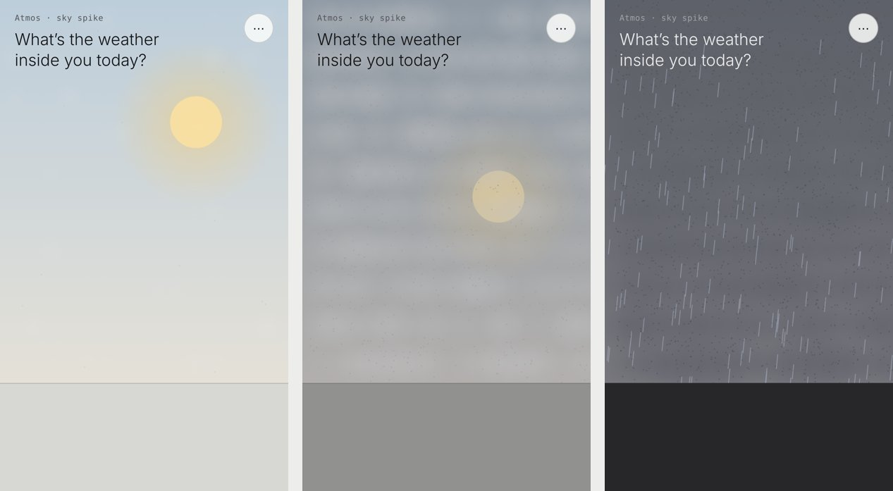

# Atmos · Make your sky

Hello World final project · proposal and spike for Week 11 (Nov 23)
Marin Chung

**Try the spike:** https://hyeeee.github.io/hello-world/week10/
**Current Atmos:** https://atmos-cd-347fa3dcbb.netlify.app/

## 1. Concept and audience

Atmos is a small web app I made in September where weather and mood journaling live in the same place. It asks one question, *What's the weather inside you today?*, and puts everyone's answers on a shared globe.

The question is poetic, but answering it right now is just a form. You tap one of six mood buttons and type a line. For the final I want to redesign that one moment so that you answer by **making your inner weather with your hands**. You drag to gather clouds, hold to make it rain, and flick up for sun or down for dusk. The sky you make becomes your entry.

**Why it matters to me.** Picking a word like "Calm" means you already know how you feel. Making a sky lets you find it while you do it, and it's closer to how weather actually feels.

**Who it's for.** People who already check the weather every morning and would spend 20 seconds on a small check in. Classmates and friends can help test it, and Atmos already has real visitors from 12 cities.

**Why not "make people come back"?** I looked at the Atmos data first. 162 devices visited but only 15 came back on a second day, and only 3 people posted more than once. I thought about designing for retention, but I can't show that in three weeks, and I'd rather make the one moment someone spends here really good.

## 2. Core experience

1. **Arrival.** The question sits on an empty, calm sky. One hint line says what your hands can do.
2. **Make.** You drag, hold and flick until the sky looks like you feel. It reacts right away.
3. **Name it (optional).** You pick the closest mood and add a line if you want.
4. **Place it.** Your sky turns into a small glyph and lands on the Atmos globe where you are.
5. **Recovery.** Clear starts over. A "⋯" button opens sliders, so it also works without gestures, with a keyboard, or with a screen reader.

## 3. Scope

**In one sentence:** make the Atmos check in something you do with your hands, so the sky you make shows how you feel.

| Priority | What |
|---|---|
| Must | Gesture sky maker (clouds, rain, light) built into Atmos as the new check in |
| Must | Saving the sky with the post and showing it again in the feed |
| Must | A no-gesture way to make the same sky (sliders, keyboard) |
| Should | Each saved sky becomes its own small glyph on the globe |
| Should | A short first-time hint, tested with someone who has never seen it |
| Nice | Wind and temperature as extra gestures |
| Nice | Sound that follows the rain |

**Stopping point.** Someone new can make a sky, post it, and find it on the globe and in the feed without my help.
**What I'd cut first.** The glyph on the globe. The sky can show in the feed only.

## 4. System plan

- **Front end.** Atmos is one HTML file with a canvas globe. The sky maker is its own canvas, and the spike is written so it can drop in as a module.
- **State.** A whole sky is just 162 small numbers: a 16 × 10 grid of cloud density, plus rain and light. That's small enough to save next to each post and to fit inside a share link.
- **Data.** Atmos already uses Supabase (`posts`, `devices`, `metoo`, `visits`). I'd add one `sky` column to `posts` and update the `create_post` and `feed` functions. Old posts without a sky keep their mood icon.
- **External.** Open-Meteo for real weather (already in Atmos). No new services and no paid accounts.
- **Resources.** My laptop, my phone, and 3 to 5 friends for tests.

## 5. Spike

**Question.** If someone makes a sky with only their hands, can another person read the feeling from it?

**Why this one.** It's the riskiest part. If skies don't read as feelings, the gesture check in is just a toy and the six mood buttons were enough.

**Prediction.** Heavy rain and bright sun will be read right most of the time (Stormy, Blue, Radiant). The in-between skies (Calm, Cozy, Foggy) will get mixed up with each other.

**Setup.** A standalone page (`index.html` in this folder).
1. I make a sky with gestures and secretly pick the mood I meant.
2. The page turns the sky into a link (the whole sky is stored in the link, nothing is saved on a server).
3. A friend opens the link, sees only the sky, and picks how it feels plus one optional word.
4. They copy the result and send it back to me.

**Results.** *(to fill in after testing this weekend)*

| # | Tester | I meant | They felt | Their word | Notes |
|---|---|---|---|---|---|
| 1 | | | | | |
| 2 | | | | | |
| 3 | | | | | |
| 4 | | | | | |
| 5 | | | | | |

**What it did and didn't show.** *(to fill in)* This only tests whether a sky can be read. It doesn't test whether making one feels good, and it's a small sample from my friends.

**Next decision.** *(to fill in)* If most skies read close enough, I build it into Atmos. If only the extremes read, I'll keep the sky as the main input but let people add a mood word on top.

## 6. Working arrangements

- **Source.** Spike and process notes in this repo (`hello-world/week10`). Atmos source will move into its own repo for the final.
- **Run it.** Open the GitHub Pages link on a phone. To run it locally, open `index.html` in a browser. No build step.
- **Roles.** Solo project. I need feedback from 3 to 5 people who haven't seen it.
- **Support.** I'd like feedback on whether the three gestures feel natural, and whether the first-time hint is enough.
- **Privacy.** The spike saves nothing on a server and the link only holds the sky and the meant mood. In Atmos, entries stay public or private like before.
- **Accessibility.** Every gesture has a slider and a keyboard key (C clouds, R rain, ↑ ↓ light). Dark skies switch the text to light so it stays readable.
- **Original project.** Atmos was first made for the SVA vibe coding "100 users in one week" assignment. This final continues it.

## 7. AI use

I build by talking with Claude. For this spike, Claude wrote the first version of the canvas drawing and gesture code from my description of the three gestures and the Atmos look (dots, lines, planes). Claude also queried the Atmos database for counts only, not entry text, to get the retention numbers above. I chose the direction, the gestures and the test, and I'll check every result with real people myself.
