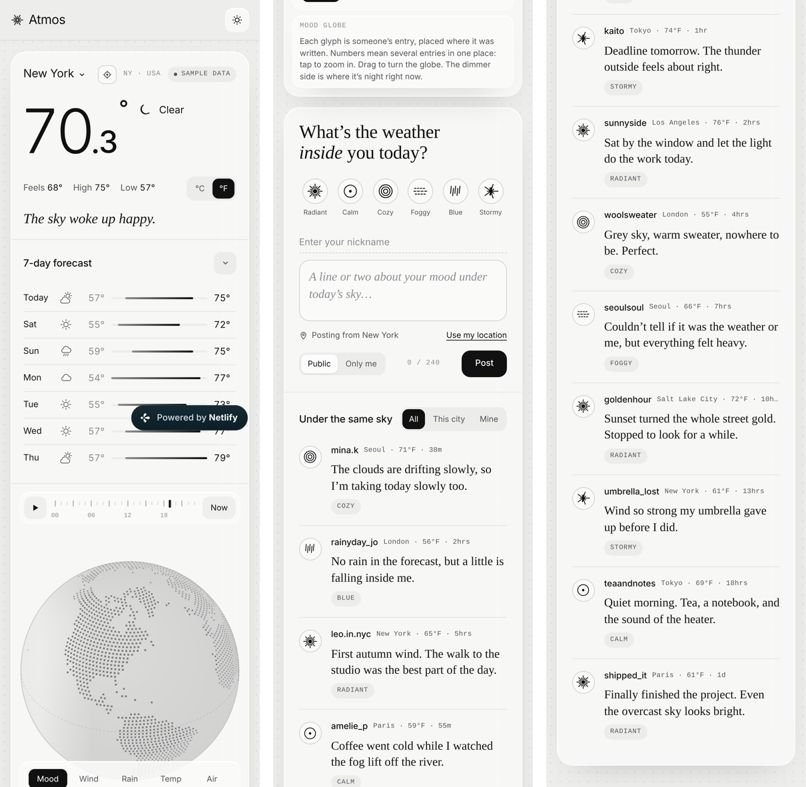

# Atmos final proposal

Hello World final project · Week 11 (Nov 23)
Marin Chung

**Atmos:** https://atmos-cd-347fa3dcbb.netlify.app/

## The project

Atmos is a small web app I made in September. It puts live weather and mood journaling in the same place and asks one question, *What's the weather inside you today?* Everyone's answers show up on a shared globe.

For the final I want to keep Atmos but change what it's mainly for. Right now it feels like a weather app with a mood line added. I want it to become **a mood journal you can use every day, where the weather is the background of each entry** instead of the main thing on the screen.

**Why.** People already check the weather in their weather app before they go out, so Atmos doesn't need to compete with that. What no weather app does is help you notice how you feel and keep it. That's the part I want to grow.

**Who it's for.** People who'd like a small daily habit of writing down how they feel, without it feeling like a big diary. Classmates and friends who haven't used Atmos can help test it.

## Where it is now

**Weather takes most of the screen.** The big temperature, the 7-day forecast, the timeline, the globe and the weather modes come first. The journal is a small panel on the side, and on a phone it's below all of that, 3 or 4 screens down.

**The journal part is thin.**
- You pick one of six moods and write up to 240 characters. That's it.
- There's no way to add a photo or say how strong the feeling is.
- You can't look back at your own entries over time, so there's no reason to keep a journal here.
- 162 devices visited Atmos, but only 31 people posted, and only 3 posted more than once.

**The design system isn't consistent.** I built Atmos fast while vibe coding, so the same kind of thing often looks a little different.
- There are 22 different font sizes, 13 corner radius values and 18 spacing values.
- Toggles, inputs and mood tags each look different in different places.

## How I'll improve it

**1. Make the journal the main thing**
- The first screen opens on today's entry, not the temperature.
- The forecast, timeline and weather modes fold away or move back. The globe stays as an "Under the same sky" view of other people's entries.
- Each entry saves the weather automatically, like "Nov 23, New York, Cloudy 48°, I feel Foggy."

**2. More ways to express how you feel**
- **Writing.** A prompt that fits your mood helps you start, like "What feels a little blurry right now?" for Foggy. You can write a line or keep going.
- **Photo.** Add one photo of the sky or a moment from the day.
- **How strong.** Show how much you feel it, from a little to a lot, so two Calm days don't look the same.

**3. A place to look back**
- My entries on a calendar or timeline, each day shown as its mood glyph with the weather next to it.
- Tap a day to read what you wrote and see the photo.

**4. Private first**
- Entries are only for you by default. You can choose to share one to "Under the same sky."

**5. One design system**
- A small type scale, radius scale and spacing scale saved as tokens.
- The same style for every toggle, input and tag.
- Keep the rule that's already there. Serif is for people's words and feelings, and sans is for the interface and data.

**Scope**

| Priority | What |
|---|---|
| Must | Journal first layout, weather moved to the background of each entry |
| Must | Writing with a prompt that fits your mood, longer entries allowed |
| Must | My entries view (calendar or timeline) |
| Must | Design tokens and shared styles applied across Atmos |
| Should | One photo per entry, private only at first |
| Should | How strong the feeling is |
| Should | Works well on a phone without long scrolling |
| Nice | Better ways to share an entry to the globe |

**Stopping point.** Someone new can write an entry with a mood, a few lines and the weather saved, and find it again later in their own entries, on a phone and on a laptop.
**What I'd cut first.** Photos, since they need storage and raise privacy questions. The journal still works without them.

## How I'll test it

I can't prove that people will use it every day in three weeks, so I'm testing whether writing in Atmos feels like journaling.

**Small experiment for this week.** Before changing anything, I'll watch 3 people who have never used Atmos try it on their phones. I'll only say "this is Atmos, try writing down how you feel today" and won't help. Then I'll ask two questions.

- Did they find where to write? How long did it take?
- Where did they get stuck or hesitate?
- Did they finish?
- "Does this feel more like a weather app or a journal?"
- "What else would you want to add to say how you feel?"

**Prediction.** I think people will read it as a weather app first, scroll past the journal on a phone, and say one line isn't enough to feel like a journal.

**Results.** *(to fill in after testing)*

| # | Found where to write | Time | Got stuck at | Finished | Weather app or journal? | Would want to add |
|---|---|---|---|---|---|---|
| 1 | | | | | | |
| 2 | | | | | | |
| 3 | | | | | | |

**For the prototype (Nov 30).** I'll do the same test with the journal first version and compare.

## Working notes

- **Source.** Atmos is built in Claude Design and deployed on Netlify. I'll make changes there. Data is in Supabase (`posts`, `devices`, `metoo`, `visits`).
- **New data.** Photos would need Supabase Storage and a column for the photo and the feeling's strength. Weather is already saved with each post.
- **Privacy.** For the numbers above I only counted visits and posts in the database, not anyone's entries. Journal entries and photos will be private by default. Testers can choose Only me.
- **Accessibility.** Every step will work with a keyboard, photos will need a short description, and any motion will turn off with reduced motion.
- **Original project.** Atmos was first made for the SVA vibe coding "100 users in one week" assignment.
- **AI use.** I build Atmos by talking with Claude. For this proposal, Claude counted the font sizes, radii and spacing in the code and the visits and posts in the database, and helped me write up the ideas. I chose the direction, what to keep and how to test it.
