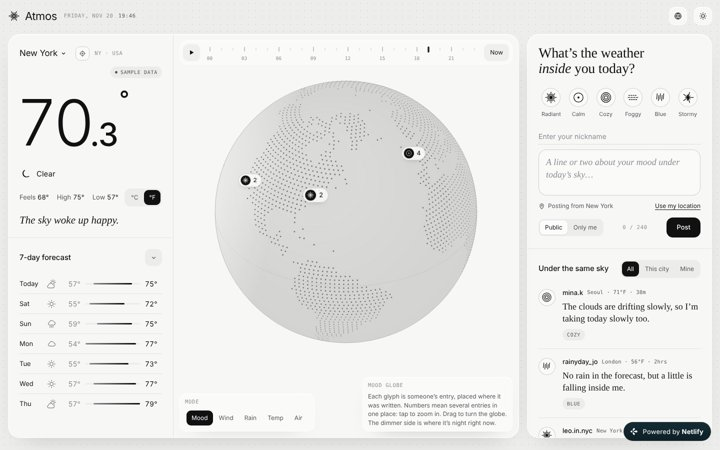

# Final project proposal

Hello World final project · Week 11
Marin Chung

My main direction is **Atmos as a daily mood journal**. I also have four other directions at the end, each aimed at a real problem in New York, so I can talk them through with you and pick one. See [Other directions](#other-directions).

**Atmos:** https://atmos-cd-347fa3dcbb.netlify.app/

## A. Atmos as a daily mood journal (main)

Atmos is a small web app I made in September. It puts live weather and mood journaling in the same place and asks one question, *What's the weather inside you today?* Everyone's answers show up on a shared globe.

For the final I want to keep Atmos but change what it's mainly for. Right now it feels like a weather app with a mood line added. I want it to become **a mood journal you can use every day, where the weather is the background of each entry** instead of the main thing on the screen.

**Why.** People already check the weather in their weather app before they go out, so Atmos doesn't need to compete with that. What no weather app does is help you notice how you feel and keep it. That's the part I want to grow.

**Who it's for.** People who'd like a small daily habit of writing down how they feel, without it feeling like a big diary. Classmates and friends who haven't used Atmos can help test it.

## Where it is now

**Weather takes most of the screen.** The big temperature, the 7-day forecast, the timeline, the globe and the weather modes come first. The journal is a small panel on the side, and on a phone it's below all of that, 3 or 4 screens down.

**The journal part is thin.**
- You pick one of six moods and write up to 240 characters. That's it.
- There's no way to add a photo or say how strong the feeling is.
- You can't look back at your own entries over time, so there's no reason to keep a journal here.
- 162 devices visited Atmos, but only 31 people posted, and only 3 posted more than once.

**The design system isn't consistent.** I built Atmos fast while vibe coding, so the same kind of thing often looks a little different.
- There are 22 different font sizes, 13 corner radius values and 18 spacing values.
- Toggles, inputs and mood tags each look different in different places.

## How I'll improve it

**1. Make the journal the main thing**
- The first screen opens on today's entry, not the temperature.
- The forecast, timeline and weather modes fold away or move back. The globe stays as an "Under the same sky" view of other people's entries.
- Each entry saves the weather automatically, like "Nov 23, New York, Cloudy 48°, I feel Foggy."

**2. More ways to express how you feel**
- **Writing.** A prompt that fits your mood helps you start, like "What feels a little blurry right now?" for Foggy. You can write a line or keep going.
- **Photo.** Add one photo of the sky or a moment from the day.
- **How strong.** Show how much you feel it, from a little to a lot, so two Calm days don't look the same.

**3. A place to look back**
- My entries on a calendar or timeline, each day shown as its mood glyph with the weather next to it.
- Tap a day to read what you wrote and see the photo.

**4. Private first**
- Entries are only for you by default. You can choose to share one to "Under the same sky."

**5. One design system**
- A small type scale, radius scale and spacing scale saved as tokens.
- The same style for every toggle, input and tag.
- Keep the rule that's already there. Serif is for people's words and feelings, and sans is for the interface and data.

**Scope**

| Priority | What |
|---|---|
| Must | Journal first layout, weather moved to the background of each entry |
| Must | Writing with a prompt that fits your mood, longer entries allowed |
| Must | My entries view (calendar or timeline) |
| Must | Design tokens and shared styles applied across Atmos |
| Should | One photo per entry, private only at first |
| Should | How strong the feeling is |
| Should | Works well on a phone without long scrolling |
| Nice | Better ways to share an entry to the globe |

**Stopping point.** Someone new can write an entry with a mood, a few lines and the weather saved, and find it again later in their own entries, on a phone and on a laptop.
**What I'd cut first.** Photos, since they need storage and raise privacy questions. The journal still works without them.

## How I'll test it

I can't prove that people will use it every day in three weeks, so I'm testing whether writing in Atmos feels like journaling.

**Small experiment for this week.** Before changing anything, I'll watch 3 people who have never used Atmos try it on their phones. I'll only say "this is Atmos, try writing down how you feel today" and won't help. Then I'll ask two questions.

- Did they find where to write? How long did it take?
- Where did they get stuck or hesitate?
- Did they finish?
- "Does this feel more like a weather app or a journal?"
- "What else would you want to add to say how you feel?"

**Prediction.** I think people will read it as a weather app first, scroll past the journal on a phone, and say one line isn't enough to feel like a journal.

**Results.** *(to fill in after testing)*

| # | Found where to write | Time | Got stuck at | Finished | Weather app or journal? | Would want to add |
|---|---|---|---|---|---|---|
| 1 | | | | | | |
| 2 | | | | | | |
| 3 | | | | | | |

**For the prototype (Nov 30).** I'll do the same test with the journal first version and compare.

## Other directions

These are four other ideas, all aimed at a real problem people in New York have. Each one uses the same kind of plan as Atmos, so they're easy to compare.

### B. Step free subway, routes that know which elevators are broken

**The problem.** If you use a wheelchair, push a stroller or carry heavy luggage, one broken elevator can make a whole station useless. You often only find out when you get there.
**The idea.** You pick where you're going and it shows a step free route that skips stations with an elevator out right now, and says plainly what to do if one breaks on the way.
**Who it's for.** Wheelchair users, parents with strollers, older riders and anyone carrying something heavy.
**Data.** The MTA publishes live elevator and escalator outages for developers.
**Must.** Live elevator status for the stations on a route, a clear warning when one is out, and a simple other way to go.
**Riskiest unknown.** Whether I can turn the outage feed into routes that are right, not just a list of broken elevators.
**Spike.** Pull today's outage feed and check it by hand against three trips I actually take.

### C. Fridge now, what's inside a community fridge right now

**The problem.** New York has community fridges where anyone can leave or take food. Maps show where they are, but not whether there's anything in them, so people walk there and find them empty.
**The idea.** Anyone passing by snaps a photo and taps what's inside. The map shows each fridge as full, some or empty, and how long ago someone checked.
**Who it's for.** People who rely on the fridges, and neighbors who want to know where to drop off food.
**Must.** A map of fridges, a 10 second update with a photo, and how fresh each update is.
**Riskiest unknown.** Whether people will bother to update it, since the whole thing depends on that.
**Spike.** Put a QR sign on one fridge near me for a few days and count how many updates come in.

### D. Notice in my language, posted notices made clear

**The problem.** Building notices about water shutoffs, heat outages, repairs or rule changes are usually posted only in English, in dense language. Neighbors who don't read English well can miss things that affect their home.
**The idea.** Take a photo of a notice and get a short, plain summary in your language, with the date, what changes and what you need to do.
**Who it's for.** Tenants with limited English, and anyone who finds these notices hard to read.
**Must.** Photo to text, a plain summary in a few languages, and a clear line that the original notice is still what counts.
**Riskiest unknown.** Whether the summary gets dates and instructions right every time, since a wrong date could cause real harm.
**Spike.** Ten real notices, with the summary checked against the original by me and a native speaker of each language.

### E. Heat log, a simple record when your apartment is too cold

**The problem.** In New York's heat season, landlords have to keep apartments at a minimum temperature ([HPD heat rules](https://www.nyc.gov/site/hpd/services-and-information/heat-and-hot-water-information.page)). Tenants without heat are told to keep a log of indoor temperatures for a complaint, but the city's log is a paper form.
**The idea.** A phone log where you tap in your indoor temperature. It saves the outdoor weather automatically, shows when the legal minimum wasn't met, and makes a clean summary for 311 or HPD.
**Who it's for.** Tenants dealing with no heat, especially in older buildings.
**Why me.** It uses what I already built in Atmos, like live weather for a place and a log over time.
**Must.** Quick indoor temperature entries, outdoor weather added automatically, rule check by time of day, and a summary to share.
**Riskiest unknown.** Whether the summary is clear and trusted enough to actually help a complaint.
**Spike.** Turn the paper log into the app's summary for one sample week and ask two tenants whether they'd use it.

### How they compare

| | A. Atmos journal | B. Step free subway | C. Fridge now | D. Notice in my language | E. Heat log |
|---|---|---|---|---|---|
| Who it helps | People building a daily habit of noticing how they feel | Riders who can't use stairs | People who rely on community fridges | Tenants with limited English | Tenants without heat |
| Starting point | Existing app with real users | New, public MTA data | New | New | New, reuses Atmos parts |
| Riskiest part | Making it feel like a journal | Right routes from outage data | Whether people update it | Accurate summaries | Trust in the summary |
| Easy to test with people | Yes | Needs riders who use elevators | Needs time at a real fridge | Needs native speakers | Needs tenants |
| Fits in three weeks | Yes | Tight | Yes | Yes | Yes |

### What I'd like your thoughts on
- Is improving an existing project like Atmos enough for a final, or is a project with clear social value better?
- For B, C, D and E, I'd be designing for people whose situation isn't mine. How should I find and test with them in three weeks, and is that okay to do for a class?
- D and E deal with homes and rules, so a mistake could hurt someone. How careful does a class project need to be there?

## Working notes

- **Source.** Atmos is built in Claude Design and deployed on Netlify. I'll make changes there. Data is in Supabase (`posts`, `devices`, `metoo`, `visits`).
- **New data.** Photos would need Supabase Storage and a column for the photo and the feeling's strength. Weather is already saved with each post.
- **Privacy.** For the numbers above I only counted visits and posts in the database, not anyone's entries. Journal entries and photos will be private by default. Testers can choose Only me.
- **Accessibility.** Every step will work with a keyboard, photos will need a short description, and any motion will turn off with reduced motion.
- **Original project.** Atmos was first made for the SVA vibe coding "100 users in one week" assignment.
- **AI use.** I build Atmos by talking with Claude. For this proposal, Claude counted the font sizes, radii and spacing in the code and the visits and posts in the database, and helped me write up the ideas. I chose the direction, what to keep and how to test it.
