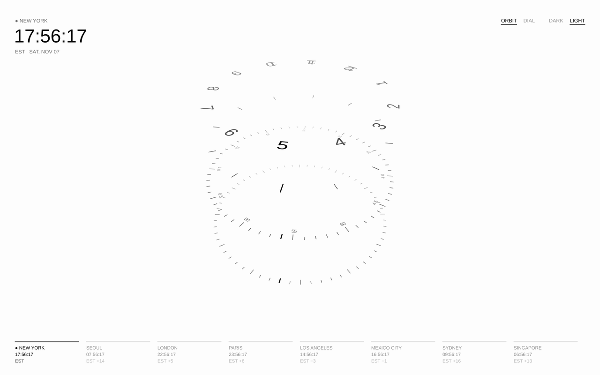
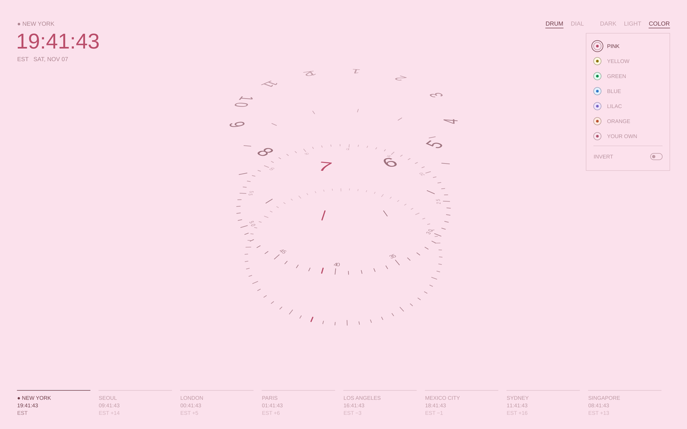

# Week 6 — Drum World Clock

A minimal 3D world clock built with p5.js (Option 2: Time Display).

- Hours, minutes and seconds sit on stacked rings that rotate so the current time faces the front.
- `Ring` class organizes each ring; nested loops draw the rings, the dot grid and the city list.
- Switch cities, DRUM / DIAL views, dark / light / color mode, and current location.

**Controls:** drag to rotate · scroll to zoom · double-click to switch view · keys 1–9 for cities · V view · L light/dark · C color mode (press again for the next palette)

## Week 8 update · Color mode

### Goal
The clock was only black and white. I wanted people to be able to make it their own, so I added a third mode next to Dark and Light called Color. Tapping Color opens a small menu that drops down under it. You pick one of six palettes, or choose any color you like with two sliders. Each palette is one color in different tones, like a pale pink background with a deep pink clock, or pale yellow with dark mustard. Invert flips it to a deep background with pale lines.

### Before and after
| Before | After |
| --- | --- |
|  |  |

The default look did not change. Color only shows up when you choose it. In color mode the strongest shade goes only on the things that mean "now" (the current tick, the current number and the big time), so the color also helps you read the time faster.

### What I haven't checked yet
- Dragging the color sliders and the menu on a real iPhone. I tested the logic in code, not every browser.
- Whether every custom color looks good. Some colors like yellow turn into a darker mustard than you might expect.
- The screenshots above were rendered from the code, so the font is a fallback and not Helvetica.

### AI use
I used Claude to help write the code.

My prompt (in Korean, translated)
> 지금 뭔가 흑백이잖아 근데 컬러를 본인이 바꿀수있다면 어떨까 모드를 하나 추가해서 그리고 애플워치에 워치페이스로 넣을수있는방법있어?
>
> It's kind of black and white right now. What if people could change the color themselves, by adding one more mode? And is there a way to put it on an Apple Watch as a watch face?

Claude's first reply (translated)
> A color mode sounds good. Going from black and white to colors you picked yourself makes a clear before and after, so it fits this assignment well. Apple doesn't allow custom watch faces you make yourself. There are two options. A photo watch face (a screenshot of the clock as the background, but it won't move), or a watch app built in Xcode and added as a complication. That takes a while, so it's beyond Monday's scope.

### Decisions
- Color is a third option next to Dark and Light instead of a separate button, so the controls stay one quiet row of words.
- The palettes live in a drop down menu under Color, one per row with a small circle and its name, instead of a row of circles. A list is easier to read and to tap, and the menu closes when you tap anywhere else.
- Each circle is a tiny preview of the palette. It shows the background with a dot of the "now" color, and the chosen one gets a thin ring.
- The browser's own color picker looked nothing like the clock, so I replaced it with two thin sliders inside the menu, one for hue and one for saturation. The sliders are drawn in the palette tones, so even the picker matches the rest.
- Invert uses the same rule backwards. Green's deep shade becomes the background, the pale tint becomes the lines and numbers, and a light but colorful shade marks "now". It is a small switch so it reads as on or off.
- My first version used dark backgrounds with bright colors. I changed it to light backgrounds with deeper shades of the same color, because one color family felt calmer and more like a set.
- Every palette, and the color you pick yourself, follows the same rule. A pale tint becomes the background, a deep calm shade becomes the lines and numbers, and a stronger shade marks "now".
- At first each color had a different saturation, so some looked louder than others. I liked the green one best, so now every palette's lines and numbers use green's exact lightness and colorfulness (measured in OKLCH, a color space where equal numbers look equal to our eyes). Only the hue changes. The backgrounds stayed the same.
- Some colors can't be that colorful at that depth on a screen (a deep yellow), so those get slightly less colorful instead of changing lightness.
- The clock usually switches to light or dark on its own by the time of day. In color mode it keeps your palette instead.
- Your color choice is saved in the browser, so it is still there next time.

### Credits
- p5.js
- Code written with help from Claude (Anthropic)

### Next question
What would this clock look like on an Apple Watch? The rings would have to work on a tiny round cornered screen, and the color mode could become the watch's own color setting.
